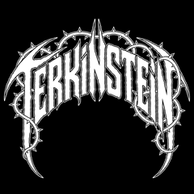

# Crepuscular Homunculus

**TERKINSTEIN's free performance firmware for the M-VAVE FM-1.**

Crepuscular Homunculus combines 64 curated sounds, six-operator FM, metallic
textures, synthesized drums and four independent tracks. Each track has four
A-D banks, up to 64 steps and four notes per step. It works on the FM-1 without
a desktop application.

This repository contains the **free firmware only**: complete source, HAL,
update loader, artwork, generators, host tests and documentation. The separate
Lead, Bass, Rhythm and Drums products and the paid companion application are
outside this repository. On-device MIDI/screen protocols remain firmware source.

## Development status

Current source: **0.26.10-dev**. The Homunculus intro/reactive HOME and saved
Homunculus/Thorn Rift choice join captured-track editing, piano roll and all-bank
SAVE/recovery. The standalone target build and focused host/ASan checks pass.
The package matches the checked local 0.26.10-dev build exactly.

**Final attended hardware release checks are still pending.** This source update
does not install firmware or publish a new Hub release. See [validation](docs/TESTING.md).

The existing [v0.22.0-dev preview](https://github.com/TerkWerX/Crepuscular_Homunculus/releases/tag/v0.22.0-dev)
keeps its original package, version, source tag and checksums. It predates the
Homunculus graphics; new features are not silently added to that older download.

## On the instrument

The four tracks are DRUM, MELODY, ATMOS and BASS. Play and record pads, metal,
synthesized kits and FM sounds, with arpeggiator, metronome and source-owned
MIDI wheels/pedals. Eight shared voices and the four-FM cap are separate from
the track count. [Complete control map](docs/PANEL_CONTROLS.md).

Startup retains the TERKINSTEIN creator splash, then the bubbling Homunculus.
A key/button dismisses the intro and also performs its normal action. HOME
reacts to actual sound. **GLO → SEL → Knob 2** selects **HOMUNCULUS** or
**THORN RIFT**; HOME returns and SAVE remembers after the normal silence guards.
Knob 1 on that page retains LINEAR/ACCEL control feel.

These are actual host LCD captures, not device photographs or timing evidence.

## Build, install and recover

[Build instructions](docs/BUILD.md) cover the external JieLi pi32v2 toolchain
and SDK. Generated headers and source artwork are included. Build/preview never
implies installation. No SDK binaries or desktop companion are bundled.

Read [installation and recovery](docs/INSTALL.md) before changing a device.
The normal updater cannot extract the installed image: retain your previous
`.fwsc` if you may return to it. **OCT− at power-on** enters USB rescue; inherited
boot/recovery guards remain. Choose the intended matching package explicitly.

## Source and credits

Portable fixed-point C; audio owns DSP state and main handles display, commands
and guarded flash saves. See [architecture](docs/DESIGN.md) and
[preset provenance](docs/PRESET_PROVENANCE.md).

**GPL-3.0-only**, derived from Dinghy with Felucca/SLOOP platform work. Preserve
the [credits and third-party terms](LICENSING.md) and distribute complete matching
source with firmware. TERKINSTEIN is the creator brand. M-VAVE/FM-1 belong to
their respective owners; this is an independent project.

[Project](https://github.com/TerkWerX/Crepuscular_Homunculus) ·
[TERKINSTEIN.COM](https://terkinstein.com/)
