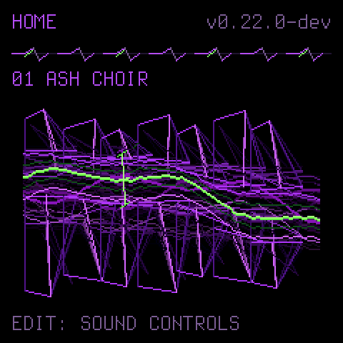
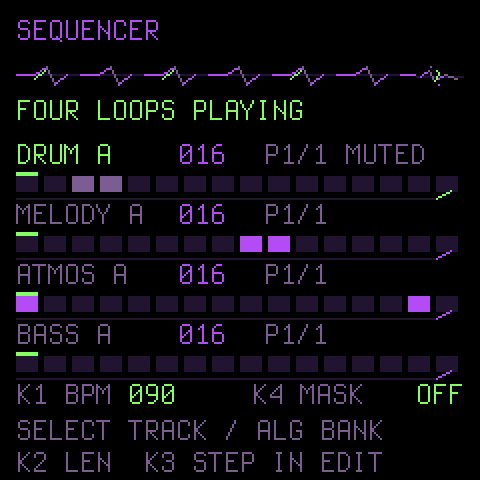

# TERKINSTEIN for the M-VAVE FM-1

**A dark performance synth and four-track groovebox for the FM-1.** TERKINSTEIN gives the small instrument 64 curated sounds, six-operator FM, metallic distortion, synthesized drum kits, sustained pads, a reactive purple-and-green display, and four 64-step tracks with four pattern banks each.

`0.22.0-dev` is a development preview. It has been built and installed on one FM-1; broader hardware qualification is still in progress. See [testing](docs/TESTING.md) for the exact scope.

## Get started

1. [Back up your songs and settings](docs/INSTALL.md#before-you-change-firmware). Keep the previous `.fwsc` file if you may want to return to it. The FM-1's USB updater cannot read the currently installed firmware image back to your computer.
2. Download the matching `.fwsc` from this repository's [Releases](https://github.com/TerkWerX/FM1-TERKINSTEIN-Firmware/releases). Use a USB data cable and install with the [FM-1 installer](docs/INSTALL.md).
3. After restart, press a key or button to dismiss the splash. HOME or GLO shows the version. Open [controls](docs/PANEL_CONTROLS.md) and [preset guide](docs/PRESET_GUIDE.md) to explore.

There is an **OCT− at power-on** USB rescue mode for interrupted updates. The [recovery instructions](docs/INSTALL.md#returning-or-recovering) cover it and the official M-VAVE firmware.

## On the instrument

| Sound | Sequencing | Performance |
| --- | --- | --- |
| Pads, basses, leads, metallic timbres, synthesized drums, 6-op FM | DRUM, MELODY, ATMOS and BASS; 64 steps per track; A–D banks | Live recording, held notes, arpeggiator, onboard metronome, MIDI notes/wheels/pedals |

The HOME screen animates **Thorn Rift** in response to what you play. Long-press FX, ENV or LFO for deeper edits. SEQ navigation does not start playback; PLAY/STOP does. See the [complete control map](docs/PANEL_CONTROLS.md).

These screens are host-rendered previews of the firmware UI. The connected FM-1 is the source of truth for sound and timing.

## Build and source

The complete firmware source, linker scripts, HAL, update loader, generators, license and build tools are in this repository. [Build instructions](docs/BUILD.md) cover the JieLi toolchain and SDK. [Preset provenance](docs/PRESET_PROVENANCE.md) describes the new sound authorship and comparison method.

TERKINSTEIN is **GPL-3.0-only**, derived from Dinghy with Felucca/SLOOP platform work. See [LICENSING.md](LICENSING.md) for credits and third-party terms. M-VAVE and FM-1 are trademarks of their owners; this is an independent project.

Visit [TERKINSTEIN.COM](https://terkinstein.com/) for demonstrations and the broader performance setup.

Developer notes

The app is fixed-point C on JieLi pi32v2. DSP stays in the audio callback; display and flash stay outside it. The custom package identity is provisionally `FM-1_960`. Builds verify size and flash-layout guards. Host tests and a target compile do not replace device measurements; a busy 0.22 session reported 3072 µs maximum app render with zero late blocks. [Performance notes](docs/PERFORMANCE.md) explain what that timer excludes.

