# Crepuscular Homunculus: illustrated guide

**For firmware 0.26.19. Learn the physical controls, build a pattern and save a four-track song.**

The pictures show the actual firmware screens, captured from the native desktop emulator. They are screen captures, not camera photographs. Example sounds, notes and values may differ from your song. You can click a picture to view it at full size.

[Back to the project](../README.md) · [Download the firmware](https://github.com/TerkWerX/Crepuscular_Homunculus/releases/tag/v0.26.19) · [Full control reference](PANEL_CONTROLS.md)

## Choose a lesson

| Start here | Then explore |
| --- | --- |
| [1. Taps, holds and knobs](#1-taps-holds-and-knobs) | [7. Envelope: how notes begin and fade](#7-envelope-how-notes-begin-and-fade) |
| [2. Play and shape a sound](#2-play-and-shape-a-sound) | [8. Hold FX: open FX CHAMBER](#8-hold-fx-open-fx-chamber) |
| [3. Give a track its own sound](#3-give-a-track-its-own-sound) | [9. Hold LFO: open FILTER LFO](#9-hold-lfo-open-filter-lfo) |
| [4. Enter a drum pattern](#4-enter-a-drum-pattern) | [10. Hold ARP: open ARPEGGIATOR](#10-hold-arp-open-arpeggiator) |
| [5. Add tracks, banks and swing](#5-add-tracks-banks-and-swing) | [11. Hold SEQ: open METRONOME](#11-hold-seq-open-metronome) |
| [6. Hold SEL: reach the piano roll](#6-hold-sel-reach-the-piano-roll) | [12. Choose the HOME artwork and knob feel](#12-choose-the-home-artwork-and-knob-feel) |
| [13. Save your song](#13-save-your-song) | [14. Recognize and cancel the reset warning](#14-recognize-and-cancel-the-reset-warning) |

## 1. Taps, holds and knobs

A **tap** means press and release promptly. A **hold** means keep the button down for **at least 700 milliseconds, about 0.7 seconds**, until the destination appears, then release. You do not need to count milliseconds precisely. Release the button fully before the next press.

A recognized hold does not also perform the short-tap action when you release it. For example, holding FX opens its controls without toggling the effect.

**SELECT is the rotary encoder. SEL is the separate button.** Instructions such as “turn SELECT” and “hold SEL” refer to different controls. K1–K4 on the screen mean Knobs 1–4. The display is not touch-sensitive.

| Button and starting page | Short tap | Hold for at least 0.7 seconds |
| --- | --- | --- |
| FX | Toggle corrosion/BITE | Open [FX CHAMBER](#8-hold-fx-open-fx-chamber) |
| LFO, with a pitched sound | Toggle filter motion | Open [FILTER LFO](#9-hold-lfo-open-filter-lfo) |
| ARP, from HOME | Turn held-note arpeggiation on/off | Open [ARPEGGIATOR](#10-hold-arp-open-arpeggiator) |
| SEQ | Open/close the sequencer without starting it | Open [METRONOME](#11-hold-seq-open-metronome) |
| SEL, on SEQUENCER | Mute/unmute the selected track | Open [ARRANGE](#6-hold-sel-reach-the-piano-roll) |
| SEL, on STEP EDIT | Return to ARRANGE | Open [PIANO ROLL](#6-hold-sel-reach-the-piano-roll) |
| SEL, on PIANO ROLL | Add a note at the cursor | Return to STEP EDIT |
| HOME | Return home or switch between TRACK SOUND and LIVE | Show [RESET DEFAULTS?](#14-recognize-and-cancel-the-reset-warning) |

Start with PLAY stopped and a comfortable listening volume. If you already have a song you want to keep, [save it](#13-save-your-song) first and use an empty bank for the exercises. No reset is needed.

## 2. Play and shape a sound

**Action: tap HOME → HOME.** If you see TRACK SOUND, tap HOME once more to reach the independent LIVE sound.

<a href="../assets/tutorial/home.png">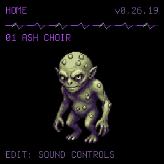</a>

1. Turn **PRESETS** to choose a sound, such as **ASH CHOIR**.
2. Play the FM-1's note keys. OCT− and OCT+ move new notes down or up an octave.
3. Tap **EDIT** to see the sound controls below.

**Action: HOME → tap EDIT → SOUND EDIT.**

<a href="../assets/tutorial/sound-edit.png">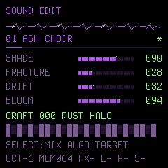</a>

Turn one of Knobs 1–4 while playing a note, then release the note and listen to its fade. Read the label beside that knob: the controls depend on the sound type. For ASH CHOIR the four labels are SHADE, FRACTURE, DRIFT and BLOOM. Kit presets instead show BODY, WIRE, DECAY and BITE.

**To leave:** tap EDIT again or tap HOME. Changing a LIVE sound does not replace the captured sounds already assigned to your tracks.

## 3. Give a track its own sound

Each of the four tracks has a captured sound. The track names are **DRUM, MELODY, ATMOS and BASS**; each can use a sound of your choice.

**Action: tap SEQ → turn SELECT to DRUM → tap HOME → TRACK SOUND / DRUM.**

<a href="../assets/tutorial/track-sound.png">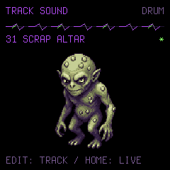</a>

1. On the SEQUENCER page, turn **SELECT** to highlight DRUM.
2. Tap **HOME**. Check that the title says **TRACK SOUND** and the upper-right label says **DRUM**.
3. Turn **PRESETS** to **SCRAP ALTAR**. Play a key to hear that captured kit.
4. Tap **SEQ**, then **EDIT**. The step-entry header should say **EDIT: SCRAP ALTAR**.

**Checkpoint:** the same kit should sound when you play the keys in TRACK SOUND and in sequencer step entry. A second HOME press from TRACK SOUND returns to LIVE. Always check the title before changing PRESETS: it tells you which sound you are editing.

## 4. Enter a drum pattern

**Action: tap SEQ → SEQUENCER.** Choose DRUM with SELECT and an **empty A–D bank** with ALGORITHM. The screenshots use A as an example; use another empty bank if A contains work.

<a href="../assets/tutorial/sequencer.png">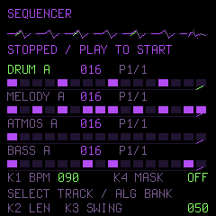</a>

For this exercise, keep PLAY stopped. Set **Knob 1 to BPM 90**, **Knob 2 to 16 steps**, **Knob 3 to SWING 0** and **Knob 4 to MASK OFF**. The illustration above shows swing 50 to identify its readout; start straight at zero.

**Action: on SEQUENCER, tap EDIT → step entry.**

<a href="../assets/tutorial/step-entry.png">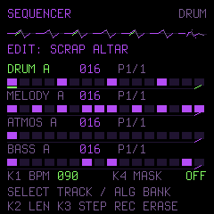</a>

The title still says SEQUENCER, but **EDIT: SCRAP ALTAR** and **K3 STEP / REC ERASE** identify step-entry mode. Knob 3 now selects a step instead of changing swing.

1. Turn **Knob 3** to the first position. Tap and release **C** to place a kick.
2. Move to positions **5, 9 and 13**, placing another C at each.
3. At positions **5 and 13**, also tap **D** to add a snare.
4. Add **E**, the closed hat, at **1, 3, 5, 7, 9, 11, 13 and 15**.

The kit mapping repeats in every octave: **C = kick, D = snare, E = closed hat, F = open hat**. A step can hold up to four notes, so the kick, snare and hat can share a position. Move the cursor yourself with Knob 3; tapping a note does not advance it.

**Made a mistake?** Move Knob 3 to that step and tap **REC** to erase the whole step, then re-enter its notes. Tapping the same note again does not delete it. To remove just one member of a chord, use the piano roll in lesson 6.

Tap **EDIT** to leave step entry. Tap **PLAY** to hear the loop; tap PLAY again to stop. If DRUM is muted, a short **SEL** tap on the sequencer overview unmutes it.

## 5. Add tracks, banks and swing

Repeat the track-sound workflow for the other rows. A simple starting arrangement is:

| Track | Try this sound | First idea |
| --- | --- | --- |
| DRUM | SCRAP ALTAR | The kick, snare and hat pattern above |
| BASS | HOLLOW ROOT | A low C at steps 1 and 9 |
| MELODY | WICKED FELT | A few spaced C, E♭ and G notes |
| ATMOS | ASH CHOIR | One note or a small chord at the start |

Choose each track with SELECT, press HOME to set its captured sound, then return to SEQ and EDIT to enter its notes. Set each bank's length deliberately. Adjust note lengths in the piano roll rather than filling every step.

**Eight voices are shared by the tracks, LIVE notes and fading tails, with at most four FM voices.** WICKED FELT uses FM. Sparse parts leave room for long fades; four tracks do not each receive eight voices.

### Hear another bank

On the sequencer overview, select a track with SELECT and turn **ALGORITHM** to its next bank. A–D are four pattern banks **for that track**, sharing the track's captured sound.

- With PLAY stopped, the bank changes immediately.
- During playback, it changes at that track's next loop boundary. A label such as **A>B** means B is queued after A.
- Other tracks keep their own bank selections. An empty bank will be silent.

**P1/4** is the first displayed group of 16 steps in a 64-step bank; it is not a time signature. Shortening a bank hides later steps without deleting them.

### Add swing

Leave step entry with EDIT. On the overview, turn **Knob 3** from **0** to **50** and listen, then try **100**. Zero is straight timing; larger settings give a stronger long–short lilt. The setting applies to the whole song and is saved with it. Changes take effect at a step-pair boundary.

## 6. Hold SEL: reach the piano roll

Use this route to edit individual notes, lengths and velocities. **SEQ EDIT and STEP EDIT are different pages.** Pressing EDIT on the sequencer is not the route to STEP EDIT.

### First hold: SEQUENCER → ARRANGE

Choose a track and bank in SEQ. **Hold SEL for at least 700 ms, then release.**

<a href="../assets/tutorial/arrangement.png">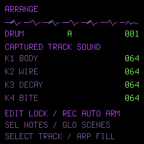</a>

**What opens:** ARRANGE. It offers captured-sound and arrangement controls. For this lesson, leave its values alone and **tap SEL once**.

### Short tap: ARRANGE → STEP EDIT

<a href="../assets/tutorial/step-edit.png">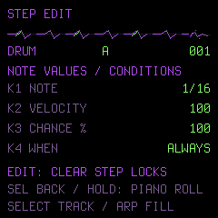</a>

**What opens:** STEP EDIT, with length, velocity, chance and condition fields. From this page, **hold SEL for at least 700 ms again, then release**.

### Second hold: STEP EDIT → PIANO ROLL

<a href="../assets/tutorial/piano-roll.png">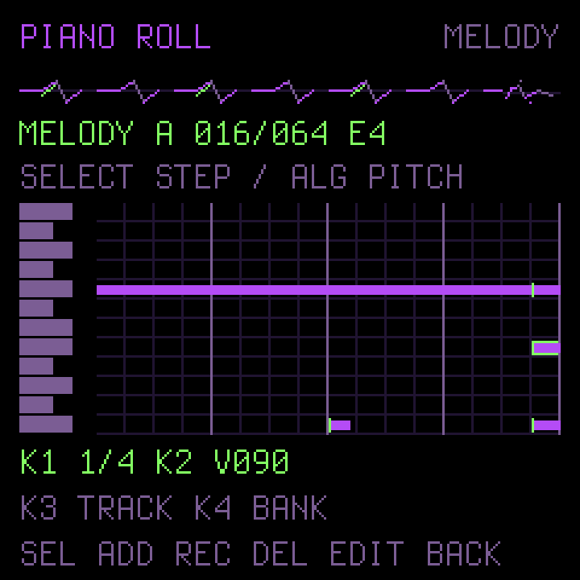</a>

This picture uses a separate MELODY example to make the note bars clear; your selected track, bank and notes stay yours.

| Control | What to do |
| --- | --- |
| SELECT encoder | Move to a step |
| ALGORITHM encoder | Move to a pitch |
| Note key | Hear that pitch and select it |
| SEL, short tap | Add a note at the step/pitch cursor |
| REC | Delete only that note |
| Knob 1 | Change the selected note's length |
| Knob 2 | Change its velocity |
| Knob 3 / Knob 4 | Choose track / bank |

Select the **start** of a note to edit it, rather than a later step crossed by its tail. Purple bars show note lengths; green markings identify onsets and the cursor/playhead. Drum envelopes still follow the kit's decay behavior.

Try making one bass note longer, or lowering one snare's velocity. Four notes fit at a step; **STEP FULL: FOUR NOTES** means you must remove a note before adding a fifth.

**To leave:** tap EDIT, or hold SEL for at least 700 ms, to return to STEP EDIT. Tap SEQ to return to the sequencer overview. These navigation actions do not insert notes or start playback. See [the piano-roll reference](PIANO_ROLL.md) for the full details.

## 7. Envelope: how notes begin and fade

**Action: from HOME, tap ENV → ENVELOPE. No hold is needed.**

<a href="../assets/tutorial/envelope.png">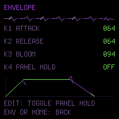</a>

With ASH CHOIR, Knob 1 changes **ATTACK**, the time the sound takes to arrive; Knob 2 changes **RELEASE**, how it fades after you release a key. Try a short note with a longer release and wait for the tail to finish. Other sound types show their own envelope labels.

**PANEL HOLD** sustains the FM-1's own keys. In this pitched-sound example, EDIT toggles it; turn it off again after trying it. Holding ENV does not bypass the envelope.

**To leave:** tap ENV again or HOME.

## 8. Hold FX: open FX CHAMBER

**Action: hold FX for at least 700 ms → FX CHAMBER. Release FX when it opens.**

<a href="../assets/tutorial/fx.png">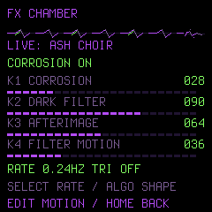</a>

The hold opens the page **without changing the on/off state**. With ASH CHOIR, read Knobs 1–4 as CORROSION, DARK FILTER, AFTERIMAGE and FILTER MOTION. Kit presets expose their kit controls instead.

To compare the corrosion/BITE processing, **tap FX briefly**. This toggles that processing; it is not a bypass of every sound-shaping control. Listen to a new note after each change.

**To leave:** tap HOME. Opening or leaving the page does not itself toggle FX.

## 9. Hold LFO: open FILTER LFO

**Action: hold LFO for at least 700 ms → FILTER LFO. Release it when the page opens.**

<a href="../assets/tutorial/lfo.png">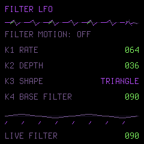</a>

The example shows **FILTER MOTION: OFF**. A short **LFO** tap enables it for a pitched sound. Knob 1 changes speed, Knob 2 depth, Knob 3 shape and Knob 4 the base filter. Start with a small depth so you can hear what the motion changes.

The kit has no filter LFO. Holding the button opens the page without toggling the feature.

**To leave:** tap HOME. A short LFO tap turns motion off again when you want a static sound.

## 10. Hold ARP: open ARPEGGIATOR

Stop the sequence and start from HOME for this exercise.

**Action: hold ARP for at least 700 ms → ARPEGGIATOR. Release it when the page opens.**

<a href="../assets/tutorial/arpeggiator.png">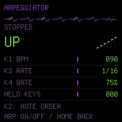</a>

The hold lets you inspect the settings without starting the arpeggiator. Knobs 1–4 set **BPM, note order, rate and gate**. Gate controls how much of each arp interval the note is held.

Tap **ARP** briefly to enable it, then hold two or three note keys. You should hear them played in the chosen order. Release the keys and tap ARP to turn it off. From ARRANGE or STEP EDIT, a short ARP tap has an arrangement-fill role, which is why this exercise starts from HOME.

**To leave the page:** tap HOME. Navigation alone is not the arp on/off switch.

## 11. Hold SEQ: open METRONOME

**Action: hold SEQ for at least 700 ms → METRONOME. Release it when the page opens.**

<a href="../assets/tutorial/metronome.png">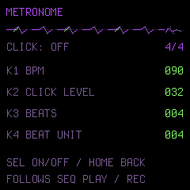</a>

Tap **SEL** to turn the click on/off. Knobs 1–4 set BPM, click level, beats per measure and beat unit. The click follows sequencer PLAY/REC; changing its meter changes the click grouping, not the length of your patterns.

**To leave:** tap HOME. Holding SEQ opens this page without starting or stopping the song. A short SEQ tap instead opens/closes the sequencer.

### If you prefer recording a performance

Use an empty bank and start from **HOME / TRACK SOUND or the sequencer overview**. Here, **REC starts recording and clears the selected bank's previous pattern**. It also starts sequence playback if stopped. Choose the intended track sound first; recording uses the active captured-track context, or captures LIVE when you are in LIVE. For DRUM recording from LIVE, select a kit first; a pitched LIVE sound is replaced by the default kit. Press REC again to finish recording, then PLAY to stop if needed.

This differs from **REC in sequencer step entry or STEP EDIT**, which erases one step, **REC in the piano roll**, which deletes one note, and **REC in ARRANGE**, which arms automation. Check the screen before pressing it.

## 12. Choose the HOME artwork and knob feel

**Action: from HOME, tap GLO → DIAGNOSTICS; tap SEL → CONTROL FEEL.**

<a href="../assets/tutorial/control-feel.png">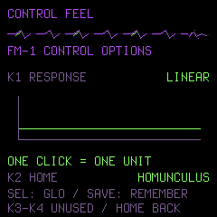</a>

Turn **Knob 1** to choose LINEAR or ACCEL. LINEAR gives regular increments; ACCEL moves eligible continuous parameters faster when you turn quickly, while slow turns remain precise.

Turn **Knob 2** to choose **HOMUNCULUS** or **THORN RIFT**. Tap HOME to see the result. Both use the same instrument controls. SAVE remembers your choice.

## 13. Save your song

**Action: stop PLAY → release keys and pedals → let tails fade → tap SAVE → wait for SAVED.**

<a href="../assets/tutorial/saved.png">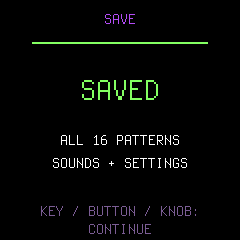</a>

The confirmation covers all **four tracks × four banks**, captured sounds and settings. You do not need to save each bank separately. Saving can wait while notes or release tails are active; pressing the button alone is not proof that the write has finished.

After SAVED, continue with a key, button or knob. Native SAVE retains the song through a normal power cycle. It is not a separate backup against overwriting firmware storage; see [installation and preservation](INSTALL.md) before changing firmware.

## 14. Recognize and cancel the reset warning

**Action: holding HOME for at least 700 ms opens RESET DEFAULTS?** This is not ordinary navigation.

<a href="../assets/tutorial/reset-warning.png">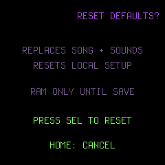</a>

**Tap HOME to cancel.** The warning also expires after ten seconds. Opening it alone does not reset anything. Reset requires releasing the buttons and then pressing physical SEL to confirm; that deliberately replaces the song, sounds and local setup in RAM. You do not need it for any lesson in this guide.

## Quick fixes

| What happened? | Check this |
| --- | --- |
| A short tap changed a feature instead of opening its page | Hold the button for at least 0.7 seconds; release only after the page appears |
| The sound changed in HOME but not in my track | Use SEQ → select the track → HOME, then check TRACK SOUND and the track label |
| Turning Knob 3 changes a step instead of swing | Leave sequencer step entry with EDIT; swing belongs to the overview |
| REC removed more than one note | In step entry it erases the entire step; use the piano roll to delete one pitch |
| A bank change is waiting | During playback it waits for that track's loop boundary; A>B shows the pending bank |
| A track is silent | Check its selected bank for notes and its mute state; tap SEL on the overview to toggle mute |
| Long chords lose older notes | Tracks and tails share eight voices, with at most four FM voices; shorten tails or simplify the overlap |
| SAVE has not confirmed | Stop playback, release all keys/pedals and panel hold, and wait for the sound to finish |

[Back to the top](#crepuscular-homunculus-illustrated-guide) · [Full controls](PANEL_CONTROLS.md) · [Sound guide](PRESET_GUIDE.md) · [Piano roll](PIANO_ROLL.md)
